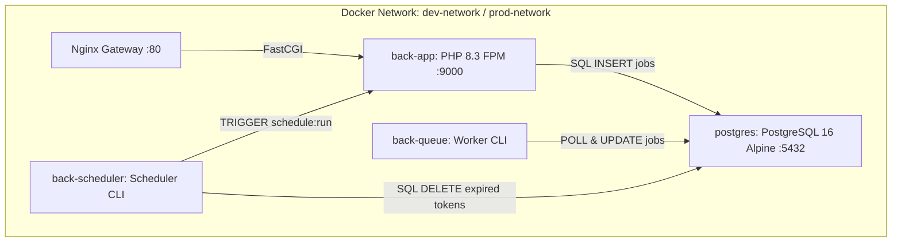

# 004 · queue-and-scheduler-infra — Design
> **Spec:** 004 · **Alcance:** infra · **Módulo:** Transversal · **Prioridad:** alta · **Depende de specs:** —
> **Status:** Done
> **Última actualización:** 2026-10-14
> **Autores:** Luis Acuña Guevara

---
## 1. Arquitectura Técnica y Topología de Contenedores



### 1.1 Servicios Docker
Reutilizan la misma imagen de PHP 8.3 construida desde `docker/php/Dockerfile` (`target: dev` en desarrollo y `target: prod` en producción).

#### Servicio `back-queue`:
```yaml
back-queue:
  build:
    context: .
    dockerfile: docker/php/Dockerfile
    target: dev
    args:
      UID: ${UID:-1000}
      GID: ${GID:-1000}
  container_name: template_queue_dev
  restart: unless-stopped
  command: php artisan queue:work --tries=3 --timeout=90 --sleep=3 --max-time=3600
  environment:
    APP_NAME: ${APP_NAME:-Laravel}
    APP_ENV: local
    APP_KEY: ${APP_KEY:-}
    DB_CONNECTION: pgsql
    DB_HOST: postgres
    DB_PORT: 5432
    DB_DATABASE: ${DB_DATABASE:-laravel_dev}
    DB_USERNAME: ${DB_USERNAME:-laravel}
    DB_PASSWORD: ${DB_PASSWORD:-secret}
    QUEUE_CONNECTION: database
  volumes:
    - ./back-laravel:/var/www/html
  depends_on:
    postgres:
      condition: service_healthy
  networks:
    - dev-network
```

#### Servicio `back-scheduler`:
```yaml
back-scheduler:
  build:
    context: .
    dockerfile: docker/php/Dockerfile
    target: dev
    args:
      UID: ${UID:-1000}
      GID: ${GID:-1000}
  container_name: template_scheduler_dev
  restart: unless-stopped
  command: php artisan schedule:work
  environment:
    APP_NAME: ${APP_NAME:-Laravel}
    APP_ENV: local
    APP_KEY: ${APP_KEY:-}
    DB_CONNECTION: pgsql
    DB_HOST: postgres
    DB_PORT: 5432
    DB_DATABASE: ${DB_DATABASE:-laravel_dev}
    DB_USERNAME: ${DB_USERNAME:-laravel}
    DB_PASSWORD: ${DB_PASSWORD:-secret}
  volumes:
    - ./back-laravel:/var/www/html
  depends_on:
    postgres:
      condition: service_healthy
  networks:
    - dev-network
```

## 2. Definición de Tareas Programadas en Laravel
En `back-laravel/routes/console.php`:

```php
use App\Modules\Auth\Models\RefreshToken;
use Illuminate\Support\Facades\Schedule;

// Limpieza diaria de tokens expirados o revocados
Schedule::call(function () {
    RefreshToken::query()
        ->where('expires_at', '<', now())
        ->orWhere('revoked_at', '!=', null)
        ->delete();
})->dailyAt('03:00')->name('prune:expired-refresh-tokens');

// Limpieza de jobs fallidos de más de 7 días
Schedule::command('queue:prune-failed --hours=168')->daily();

// Limpieza de batches antiguos si aplica
Schedule::command('queue:prune-batches --hours=48')->daily();
```

## 3. Integración en `Makefile`
Agregar objetivos para gestionar los nuevos servicios:
- `make queue-logs`: Ver logs del worker.
- `make queue-restart`: Reiniciar el worker tras cambios en código de Jobs.
- `make scheduler-logs`: Ver logs del programador de tareas.
