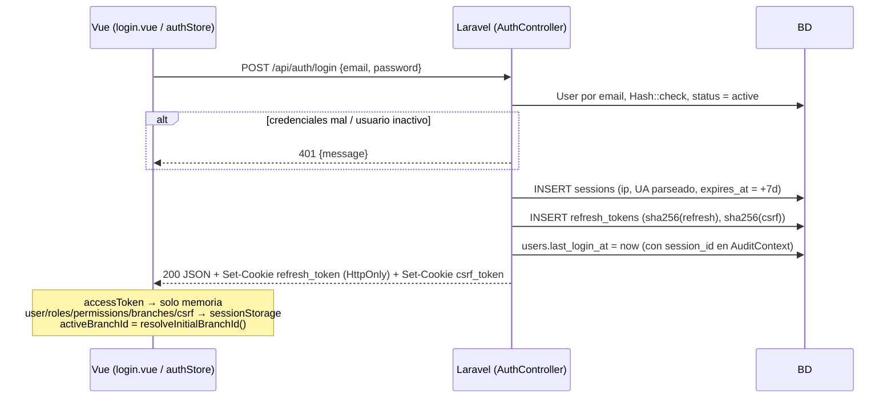
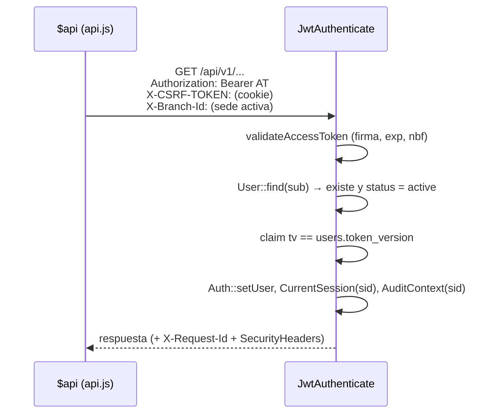
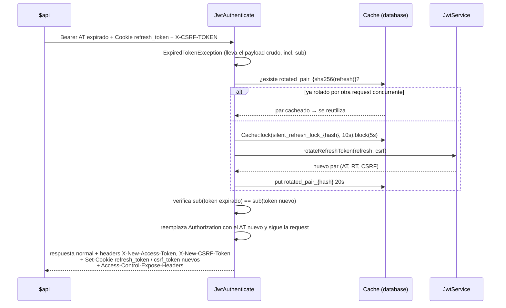
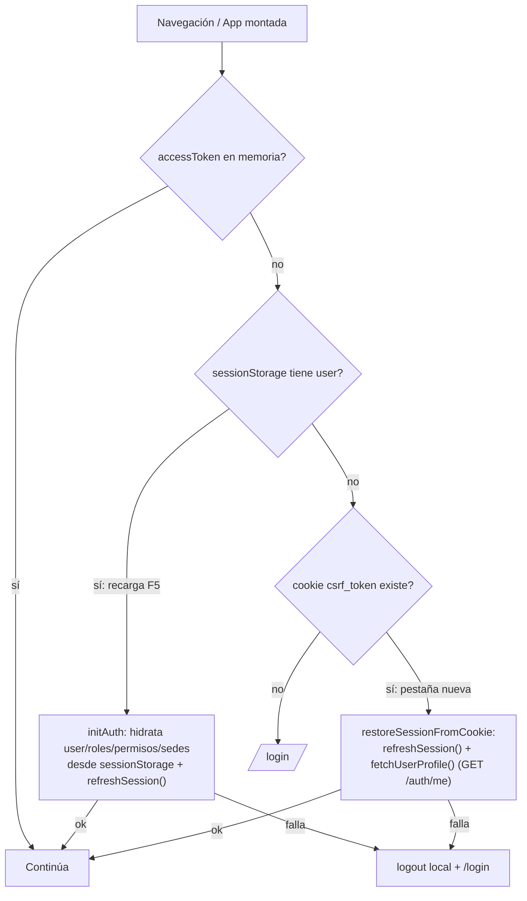
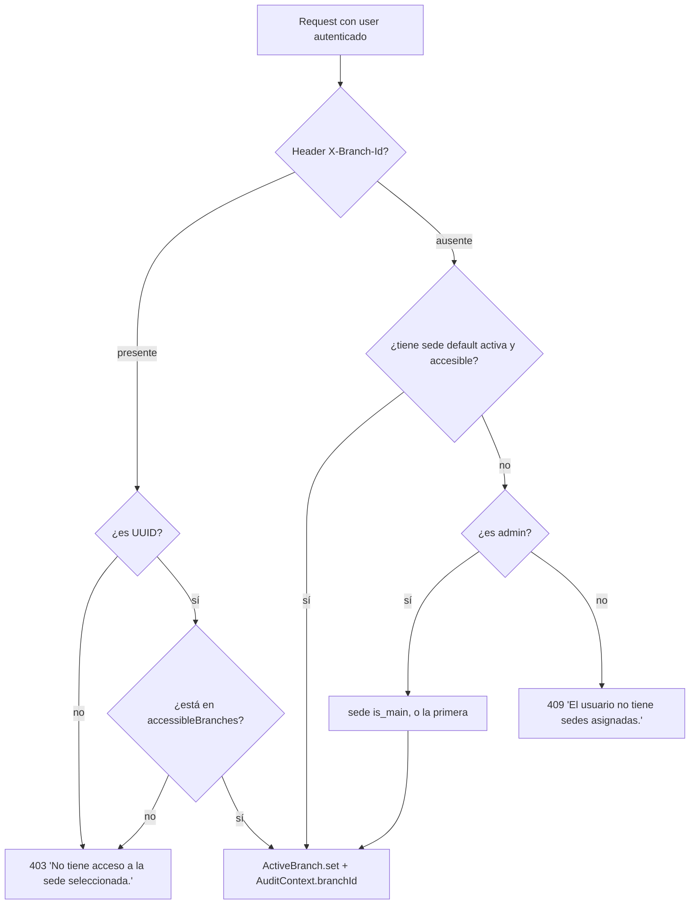

# Autenticación, sesiones y sedes

Documento de referencia de cómo funcionan el login, los tokens, el refresh, el CSRF, las sesiones por dispositivo y el contexto multi-sede, tanto en backend (Laravel) como en frontend (Vue). Todo lo descrito está verificado contra el código; las rutas de archivo se indican en cada sección.

---

## 1. Visión general

El sistema es una **API stateless con JWT**. No usa la sesión HTTP de Laravel (`SESSION_DRIVER=array`; el middleware `web`/`StartSession` no está activo en `routes/api.php`). Lo que el sistema llama "sesión" es una entidad de dominio propia (`App\Modules\Auth\Models\Session`: un dispositivo/navegador logueado).

Hay **cuatro piezas** que viajan entre navegador y servidor:

| Pieza | Qué es | Dónde vive en el cliente | Vida |
|---|---|---|---|
| **Access token** | JWT HS256 firmado | Solo memoria (`authStore.accessToken`), nunca se persiste | 15 min (`JWT_ACCESS_EXPIRES_IN=900`) |
| **Refresh token** | 32 bytes aleatorios (`bin2hex`), opaco, no es JWT | Cookie `refresh_token`, **HttpOnly** | 7 días (`JWT_REFRESH_EXPIRES_IN=604800`) |
| **CSRF token** | 32 bytes aleatorios, ligado 1:1 al refresh token | Cookie `csrf_token`, **legible por JS** (no HttpOnly) | Igual que el refresh token |
| **Sede activa** | UUID de la sede con la que se opera | `sessionStorage['active_branch_id']` (por pestaña) | La pestaña |

Y **tres tablas** en backend:

- `sessions` — una fila por login/dispositivo. Su `id` es estable durante toda la vida de la sesión, **sobrevive a las rotaciones** de refresh token.
- `refresh_tokens` — una fila por refresh token emitido (se guarda solo el **hash SHA-256** del token y del CSRF). Cada rotación crea una fila nueva y marca la anterior como revocada, todas enlazadas por `session_id`.
- `users.token_version` — entero que se incrusta en el JWT (claim `tv`) y permite invalidar de golpe todos los access tokens de un usuario.

### Por qué hay "dual token" + CSRF

- El **access token** va en el header `Authorization: Bearer`, escrito explícitamente por JS en cada request. Como el navegador no lo adjunta solo, **no es vulnerable a CSRF**, y al no persistirse tampoco a robo desde storage por XSS (un XSS sí podría leerlo de la memoria mientras la pestaña viva, pero no sobrevive a un reload).
- El **refresh token** vive en una cookie HttpOnly: JS no puede leerlo (mitiga robo por XSS), pero el navegador **sí lo adjunta solo**, así que sí es susceptible a CSRF. Por eso el endpoint de refresh exige además el **CSRF token** por header (patrón *double-submit*): un sitio atacante puede provocar que el navegador mande la cookie, pero no puede leer `csrf_token` (otra origin) para ponerlo en el header.

---

## 2. Archivos clave

### Backend (`back-laravel/`)

| Archivo | Rol |
|---|---|
| `app/Modules/Auth/Controllers/AuthController.php` | `login`, `refresh`, `logout`, `me` |
| `app/Modules/Auth/Services/JwtService.php` | Emisión/validación de JWT, creación y rotación de pares, revocación, fábrica de cookies |
| `app/Modules/Auth/Middleware/JwtAuthenticate.php` | Valida el Bearer en cada request; hace **refresh silencioso** si el access token expiró |
| `app/Modules/Auth/Models/Session.php`, `RefreshToken.php` | Modelos (UUID) |
| `app/Modules/Profile/*` | Cambio de contraseña, listado y revocación de sesiones |
| `app/Http/Middleware/ResolveActiveBranch.php` (alias `branch`) | Resuelve la sede activa desde `X-Branch-Id` |
| `app/Http/Middleware/EnsureRequestId.php`, `SecurityHeaders.php` | Headers globales |
| `app/Support/Branch/ActiveBranch.php`, `BranchAccessGuard.php` | Sede activa de la request y autorización por registro |
| `app/Support/Auth/CurrentSession.php`, `app/Support/Audit/AuditContext.php` | Contexto request-scoped (sesión y sede) para auditoría |
| `app/Modules/Maintenance/Services/UserBranchService.php` | Qué sedes puede usar un usuario |
| `config/jwt.php`, `config/cors.php`, `config/session.php` | Configuración |
| `bootstrap/app.php` | Alias de middlewares y render JSON de errores |
| `routes/api.php` | Rutas y middlewares |

### Frontend (`front-vue/src/`)

| Archivo | Rol |
|---|---|
| `utils/api.js` | Cliente `$api` (ofetch): inyecta headers, captura tokens rotados, reintenta ante 401 |
| `modules/auth/stores/authStore.js` | Store Pinia: login, refresh, restore, logout, sede activa |
| `modules/auth/services/authApi.js` | Llamadas `/auth/*` |
| `plugins/1.router/authGuard.js` | Guard de navegación (sesión + permisos por ruta) |
| `utils/authSync.js` | Lock de refresh entre pestañas y broadcast de logout |
| `utils/csrfCookie.js` | Lectura de la cookie `csrf_token` |
| `utils/sessionStorage.js` | Respaldo de usuario/roles/permisos/sedes en `sessionStorage` |
| `components/common/BranchSwitcher.vue` | Selector de sede |
| `App.vue` | `initAuth()` al montar y listener de logout remoto |

---

## 3. Cookies

Las crea `JwtService` (`makeRefreshTokenCookie`, `makeCsrfCookie`) y siempre se emiten **juntas** (regla de `.agents/rules/auth-session.md`).

| Atributo | `refresh_token` | `csrf_token` |
|---|---|---|
| HttpOnly | **sí** (`session.http_only`, default `true`) | **no** (hardcoded `false`) |
| Max-Age | 7 días | 7 días |
| Path | `session.path` (`/`) | `/` |
| Domain | `SESSION_DOMAIN` (null → host actual) | igual |
| Secure | `SESSION_SECURE_COOKIE` (**null por defecto → no Secure**) | igual |
| SameSite | `SESSION_SAME_SITE` (default `lax`) | igual |

> ⚠️ `Secure` queda desactivado salvo que se configure `SESSION_SECURE_COOKIE=true`. En producción con HTTPS debe activarse.

Para **borrar** ambas (logout o refresh inválido) se emiten con `cookie()->forget(...)` (`makeForgetRefreshTokenCookie`, `makeForgetCsrfCookie`).

### Mismo origen (importante para que las cookies funcionen)

El front llama a `VITE_API_BASE_URL=/api` (ruta relativa). Así el navegador ve **un solo origen**:

- **Dev**: `http://localhost` → nginx (`docker/nginx/default.dev.conf`) envía `/api|/sanctum|/up` a PHP-FPM y todo lo demás al dev server de Vite. Alternativamente el proxy de Vite (`vite.config.js`) reenvía `/api` a `http://api.localhost`.
- Resultado: las cookies se guardan para el host del front y viajan en cada `/api/*` sin depender de CORS.

CORS (`config/cors.php`) tiene `supports_credentials: true` y orígenes localhost permitidos, por si se accede directo a `api.localhost`.

---

## 4. El access token (JWT)

Emitido por `JwtService::issueAccessToken()`. Claims:

| Claim | Contenido |
|---|---|
| `iss` / `aud` | `JWT_ISSUER` / `JWT_AUDIENCE` (por defecto `APP_URL`) |
| `iat`, `nbf`, `exp` | emisión, ahora, ahora + 900 s |
| `sub` | `user.id` (UUID) |
| `email`, `name` | datos del usuario |
| `roles`, `permissions` | **snapshot informativo** al emitir (ver nota abajo) |
| `tv` | `users.token_version` al emitir |
| `jti` | UUID único del token |
| `sid` | `sessions.id` (la sesión lógica) |

Firma HS256 con `JWT_SECRET` (si mide < 32 caracteres cae a `APP_KEY`, y luego a una constante de respaldo).

> **Los permisos NO se evalúan desde el token.** `JwtAuthenticate` carga el `User` de la BD en cada request y los middlewares `permission:*` (Spatie) consultan la BD (con caché de Spatie). El claim `permissions` es solo informativo. Por eso un cambio de permisos surte efecto de inmediato en backend, aunque el token siga vigente.

---

## 5. Flujos de autenticación

### 5.1 Login

`POST /api/auth/login` — sin JWT, protegido por `throttle:login` (5 intentos/min por `email|ip`).

**Cuerpo de la respuesta**: `access_token`, `csrf_token`, `expires_in`, `token_type: "Bearer"`, `user {id,name,email}`, `roles[]`, `permissions[]` (slugs), `branches[]` (las accesibles).

**En el front** (`authStore.login`): guarda `accessToken` solo en el state; persiste en `sessionStorage['auth-storage']` el usuario, roles, permisos, sedes y csrf; resuelve la sede inicial (§8); y trae el resumen de configuración (`configStore.fetchSummary()`).

> Los dos casos de fallo (credenciales y usuario inactivo) devuelven 401 con mensajes distintos ("Credenciales incorrectas." / "Usuario inactivo.").

### 5.2 Request autenticada normal

Validaciones de `JwtAuthenticate::handle`, en orden (todas responden **401** con `{success:false, message, errors:null}`):

1. No hay Bearer → "No autenticado. Token de acceso no proporcionado."
2. Firma inválida / token malformado → mensaje de `validateAccessToken`.
3. Token expirado → entra al **refresh silencioso** (§5.3).
4. Sin `sub`, usuario inexistente o `status != active`.
5. `tv` ≠ `users.token_version` → "Token revocado o versión no válida."

> **No se consulta el estado de `sessions`** en esta ruta: un access token vigente sigue siendo válido aunque su sesión se haya revocado, hasta que expire (máx. 15 min) o cambie `token_version`. Ver §11.

### 5.3 Access token expirado → refresh silencioso (backend)

Es la primera línea de defensa: si el access token expiró pero el navegador envía la cookie `refresh_token` y el header CSRF, `JwtAuthenticate` rota los tokens **en la misma request**, sin que el front tenga que reintentar.

Detalles:

- Falla (401 "Token expirado.") si no hay cookie de refresh, si no hay CSRF, si la rotación falla, o si el `sub` no coincide.
- El **lock atómico** (10 s de vida, espera 5 s) garantiza que solo UNA request concurrente rote; las demás reciben el par cacheado.
- Si el driver de caché no soporta locks (`BadMethodCallException`) cae a rotación directa.
- Los headers `X-New-*` se añaden **después** de ejecutar el controller, así que la request de negocio ya se ejecutó con el token nuevo.

### 5.4 Refresh explícito

`POST /api/auth/refresh` — **no** pasa por `JwtAuthenticate` ni por throttle. Lo usa el front al arrancar (F5, pestaña nueva) y como respaldo ante un 401.

Entrada: cookie `refresh_token` + header `X-CSRF-TOKEN`. (El controller también acepta, como alternativas, el header `X-Refresh-Token` / `input refresh_token` y `input csrf_token`, pensadas para clientes no-navegador.)

`JwtService::rotateRefreshToken()` corre en una **transacción** y evalúa en este orden:

| # | Condición | Resultado |
|---|---|---|
| 1 | `sha256(token)` no existe en `refresh_tokens` | 401 "inválido o no encontrado" |
| 2 | CSRF vacío o `hash_equals` falla | **403** "Token CSRF inválido" |
| 3 | `expires_at` vencido | 401 "expirado" |
| 4 | Token ya revocado | si la sesión está inactiva → 401; si está dentro del **periodo de gracia (20 s)** y hay par cacheado → devuelve ese par; si no → 401 "revocado" |
| 5 | Sesión (con `lockForUpdate`) revocada o expirada | 401 |
| 6 | Usuario no encontrado / inactivo | 401 |
| ✔ | Todo OK | marca el token viejo `revoked_at=now` + `grace_period_expires_at=now+20s`; `createTokenPair` reutilizando la misma `Session` (actualiza ip, UA, `last_used_at` y **extiende `expires_at` otros 7 días**); cachea el par 20 s |

Respuesta de `AuthController::refresh`:

- **200**: `{access_token, csrf_token, expires_in, token_type}` + cookies nuevas.
- **403** (CSRF no coincide): solo el mensaje; **no borra cookies**. Razón: otra pestaña pudo haber rotado y esta llegó con un CSRF desactualizado — no es un ataque necesariamente.
- **401** (cualquier otro fallo): mensaje + **borra ambas cookies** (`forget`).

Consecuencias de diseño:

- **Rotación con sesión deslizante**: cada refresh exitoso extiende la sesión 7 días desde ese momento. Una sesión usada al menos una vez por semana no caduca nunca.
- **Periodo de gracia**: tolera que dos requests/pestañas presenten el mismo refresh token casi a la vez (la segunda recibe el par ya generado en vez de un 401).

### 5.5 Restauración al cargar la página (F5 / pestaña nueva)

Al montar, `App.vue` llama `authStore.initAuth()`; además el **guard del router** (`authGuard.js`) hace lo mismo antes de cada navegación sin `accessToken`.

- La cookie `csrf_token` es la **señal** de "hay una sesión de navegador" (la HttpOnly no se puede inspeccionar desde JS).
- En una pestaña nueva el `sessionStorage` está vacío, por eso se hace `/auth/me` para recuperar usuario, roles, permisos y sedes.
- Si la ruta tiene `meta.action`, el guard valida el permiso (admin/superadmin, `all` y `*` pasan siempre) y redirige a `/` si no lo tiene.

### 5.6 Refresh reactivo en el front (respaldo ante 401)

Si una request devuelve 401 (y no es `/auth/login|refresh|logout`), `api.js › onResponseError`:

1. Llama `handleTokenRefresh()`, **deduplicado** con `isRefreshing`/`refreshPromise` (todas las requests 401 simultáneas esperan el mismo refresh).
2. `authStore.refreshSession()` → `withRefreshLock(() => authApi.refreshToken())`.
3. Si funciona: actualiza el header `Authorization` con el nuevo AT y reintenta **una vez** (`retry = 1`, `retryStatusCodes = [401]`).
4. Si falla: `authStore.logout()` y `window.location.href = '/login'`.

Dado que el backend ya hace refresh silencioso (§5.3), este camino se usa sobre todo cuando el 401 no vino de expiración (p. ej. `tv` cambió, usuario desactivado) o cuando la cookie de refresh es lo único válido.

### 5.7 Captura de tokens rotados en el front

`api.js › onResponse`: si la respuesta trae `X-New-Access-Token`, llama `authStore.updateTokens(at, csrf)` (actualiza memoria y el `csrfToken` del `sessionStorage`). Para que el navegador deje leer esos headers en contexto CORS, el backend los incluye en `Access-Control-Expose-Headers`.

### 5.8 Logout

`POST /api/auth/logout` — sin JWT. Lee el refresh de la cookie y llama `revokeRefreshToken` → `revokeSession(session_id)`: marca la sesión `revoked_at` **y todos sus refresh tokens**. Siempre responde 200 y borra ambas cookies.

Front (`authStore.logout`):

1. `broadcastLogout()` por `BroadcastChannel('auth')` para que las demás pestañas cierren (en `App.vue`, `onRemoteLogout` ejecuta `logout({broadcast:false})` y redirige a `/login`).
2. `authApi.logout()` (se ignora cualquier error para garantizar limpieza local).
3. Limpia el state, `sessionStorage['auth-storage']` y `active_branch_id`.

### 5.9 Perfil: `GET /api/auth/me`

Con JWT. Devuelve `user`, `roles`, `permissions` (slugs) y `branches`. Se usa para restaurar el estado en pestañas nuevas. Si responde 401/403, `fetchUserProfile` hace logout.

---

## 6. Sesiones por dispositivo

Cada login crea una `Session` con IP, `user_agent` (truncado a 500), y `device_type/browser/platform` parseados por `UserAgentParser`. Se actualizan en cada rotación.

`/api/v1/profile` (JWT + `throttle:api`, sin permiso adicional):

| Endpoint | Acción |
|---|---|
| `GET /profile/sessions` | Sesiones activas (no revocadas ni vencidas) ordenadas por último uso; marca `is_current` comparando con `sid` del JWT |
| `DELETE /profile/sessions/others` | `revokeOtherSessions`: revoca (sesión + refresh tokens) todas menos la actual; bloquea las filas `ORDER BY id` para evitar deadlocks. Devuelve `revoked_sessions_count` |
| `PUT /profile/password` | Ver §7 |

La sesión actual se identifica por el claim **`sid` del access token** (`request->attributes['session_id']`).

---

## 7. Invalidación masiva: `token_version` y cambios de contraseña

`users.token_version` (inicia en 1) se incrementa en:

- **Cambio de contraseña propio** (`ProfileService::updatePassword`): sube `token_version`, revoca todas las sesiones del usuario y **crea un par nuevo para el dispositivo actual**. Respuesta: `data.{access_token,csrf_token,expires_in}` + cookies nuevas + headers `X-New-Access-Token`/`X-New-CSRF-Token`. El que cambia la contraseña sigue logueado; los demás dispositivos caen.
- **Edición de usuario por un administrador** (`UserService::update`) cuando cambian **roles, contraseña o estado**: sube `token_version` y **borra** (DELETE) las filas de `sessions` del usuario (los `refresh_tokens` caen por FK en cascada).

Efecto: el siguiente request con un access token viejo falla en `JwtAuthenticate` por `tv` distinto (401). El siguiente refresh falla porque ya no existe el token (401 + cookies borradas) → el usuario va a `/login`.

---

## 8. Multi-sede (sucursales)

### 8.1 Modelo

- Un usuario tiene N sedes vía pivot `user_branches` (`is_default` marca la predeterminada).
- `UserBranchService::accessibleBranches($user)`:
  - **Admin** (`hasRole('admin')`): todas las sedes **activas**; si no tiene una por defecto, la sede `is_main` actúa como default.
  - **Resto**: solo sus sedes activas asignadas.
- La sede **no va en el JWT**. Se envía por request, así que cambiar de sede no requiere nuevo token.

### 8.2 Frontend: elegir y guardar la sede activa

`resolveInitialBranchId(branches)` decide la sede al login, al hidratar y al cargar `/auth/me`, en este orden:

1. `sessionStorage['active_branch_id']` (si sigue siendo una sede accesible).
2. `localStorage['last_branch_id']` (última usada en este navegador) — y la copia a `sessionStorage`.
3. La sede `is_default`, o la primera; se guarda en ambos storages.

Por qué dos storages: `sessionStorage` es **por pestaña** (cada pestaña puede operar en una sede distinta a la vez); `localStorage` solo recuerda la última para abrir pestañas nuevas.

`setActiveBranch(id)` valida que el id esté en `branches`, y lo escribe en ambos storages. `BranchSwitcher.vue` (visible solo si hay más de 1 sede) llama `setActiveBranch` y luego **recarga la página** (`router.go(0)`) para descartar todo estado de la sede anterior.

`api.js` inyecta `X-Branch-Id` automáticamente en **todas** las requests (si el header no viene ya puesto), leyendo `authStore.activeBranchId` y, como respaldo, `sessionStorage`. Ningún componente debe añadirlo a mano (regla `multi-branch.md`).

### 8.3 Backend: `ResolveActiveBranch` (alias `branch`)

Se aplica solo a los grupos de rutas con datos de sede (`->middleware('branch')`: almacenes, cajas, series, ventas, compras…), **después** de `JwtAuthenticate`.

- La **sede nunca se confía**: siempre se contrasta con las sedes accesibles del usuario en esa request.
- `ActiveBranch` es un objeto request-scoped. **Solo controllers y FormRequests** lo leen (`app(ActiveBranch::class)`); los Services reciben la sede por parámetro para poder correr en jobs/comandos/scheduler.
- Para `show/update/acciones` sobre un registro concreto no se exige que coincida con la sede activa: se autoriza con `BranchAccessGuard::assertAccessible($user, $model->branch_id)` → **404** si la sede del registro no es accesible (no filtra su existencia). `scopeQuery()` filtra listados por sedes accesibles (el admin ve todo).
- `AuditContext` recibe `branch_id` y `session_id`; `Activity` (audit log) los estampa automáticamente en cada actividad.

---

## 9. Headers HTTP

### 9.1 Request (front → back)

| Header / cookie | Origen | Quién lo envía | Cuándo | Quién lo consume |
|---|---|---|---|---|
| `Authorization: Bearer <AT>` | `authStore.accessToken` | `api.js` | Si hay access token | `JwtAuthenticate` |
| `X-CSRF-TOKEN` | cookie `csrf_token` (respaldo: store, `sessionStorage`) | `api.js` | En `/auth/refresh` y `/auth/logout`, y en cualquier request si hay AT y CSRF | `AuthController::refresh` y refresh silencioso de `JwtAuthenticate` (**solo ahí se valida**) |
| `X-Branch-Id` | `authStore.activeBranchId` | `api.js` | Si hay sede activa | `ResolveActiveBranch` |
| `Cookie: refresh_token=…; csrf_token=…` | Navegador (`credentials: 'include'`) | automático | Cada request al mismo origen | `extractRefreshToken` |
| `X-Request-Id` | — | opcional | Si el cliente lo envía, se respeta | `EnsureRequestId` |
| `X-Refresh-Token` | — | clientes no-navegador | Alternativa a la cookie | `extractRefreshToken` |

> El front adjunta `X-CSRF-TOKEN` en todas las requests autenticadas, pero el backend **solo lo valida durante una rotación de refresh** (explícita o silenciosa). En requests normales no es necesario porque el Bearer no es ambient.

### 9.2 Response (back → front)

| Header | Cuándo | Para qué |
|---|---|---|
| `Set-Cookie: refresh_token` (HttpOnly) | login, refresh, silent refresh, cambio de contraseña | Entregar/rotar el refresh |
| `Set-Cookie: csrf_token` | ídem | Entregar/rotar el CSRF (legible por JS) |
| `Set-Cookie: …; expires=pasado` | logout, refresh fallido (401) | Borrar cookies |
| `X-New-Access-Token` | silent refresh en `JwtAuthenticate`; cambio de contraseña | El front reemplaza su AT en memoria |
| `X-New-CSRF-Token` | ídem | El front actualiza su CSRF de respaldo |
| `Access-Control-Expose-Headers` | cuando hay rotación | Permite a JS leer los `X-New-*` cross-origin (CORS global además expone `X-New-Access-Token`, `X-New-CSRF-Token`, `X-Branch-Id`) |
| `X-Request-Id` | **toda** respuesta, incluso errores | Correlación en logs; se incluye en el cuerpo de los 500 |
| `X-Content-Type-Options: nosniff`, `X-Frame-Options: SAMEORIGIN`, `X-XSS-Protection: 1; mode=block`, `Referrer-Policy: strict-origin-when-cross-origin`, `Permissions-Policy: camera=(), microphone=(), geolocation=()` | **toda** respuesta (`SecurityHeaders`) | Hardening básico |
| `Retry-After` | 429 | Tiempo de espera (también en el cuerpo `retry_after`) |

> `X-Branch-Id` figura como header expuesto por CORS, pero el backend **no lo emite** en respuestas (solo lo lee).

### 9.3 Códigos de error relevantes

Todos los errores bajo `api/*` se renderizan como JSON (`bootstrap/app.php`).

| Código | Cuándo |
|---|---|
| 401 | Sin/inválido/expirado token, usuario inactivo, `tv` distinto, refresh inválido (con borrado de cookies en `/auth/refresh`) |
| 403 | CSRF no coincide en refresh (sin borrar cookies); permiso Spatie denegado; sede inaccesible (`ResolveActiveBranch`) |
| 404 | Recurso inexistente o de una sede no accesible (`BranchAccessGuard`) |
| 409 | Usuario sin sedes asignadas (sin `X-Branch-Id`) |
| 422 | Validación |
| 429 | Rate limit (`login` 5/min por email+IP; `api` 120/min por usuario o IP) |
| 500 | Error interno (mensaje genérico + `request_id`) |

---

## 10. Coordinación entre pestañas

Todas las pestañas del navegador comparten las cookies (y por tanto **el mismo refresh token/CSRF**) pero **no** el `sessionStorage` ni la memoria (cada pestaña tiene su propio access token y su sede activa).

Problema: si dos pestañas rotan el refresh a la vez, la segunda usa un token ya revocado. Soluciones combinadas:

1. **`withRefreshLock()`** (`authSync.js`): usa la Web Locks API (`navigator.locks`, lock `auth-refresh`) para serializar el refresh entre pestañas. El CSRF se lee de la cookie **dentro** del lock, así siempre es el vigente. Sin soporte de Web Locks, ejecuta directo.
2. **CSRF desde cookie**: `getCsrfCookie()` en cada request; `sessionStorage` es solo respaldo. La cookie siempre corresponde al último refresh emitido, lo haya rotado la pestaña que sea.
3. **Periodo de gracia de 20 s + caché del par rotado**: red de seguridad en backend.
4. **403 sin borrar cookies** cuando el CSRF no coincide.
5. **`BroadcastChannel('auth')`**: logout en una pestaña cierra las demás.

---

## 11. Observaciones y puntos de atención

Cosas que encontré leyendo el código; no son necesariamente bugs, pero conviene que las tengas presentes:

1. **Revocar una sesión no mata el access token vigente.** `JwtAuthenticate` valida firma, `tv` y usuario, pero **no consulta `sessions.revoked_at`**. Tras `logout` o `DELETE /profile/sessions/others`, el access token de esa sesión sigue funcionando hasta 15 min. Lo que sí queda cortado de inmediato es el refresh. Si necesitas corte instantáneo habría que verificar el `sid` (con caché) en el middleware.
2. **No hay detección de reutilización de refresh token.** Presentar un token ya revocado fuera de los 20 s de gracia da 401 y borra cookies del cliente, pero **no revoca la sesión/familia** (sería lo estándar para detectar robo).
3. **`/auth/logout` y `/auth/refresh` no tienen throttle.** Además, `logout` no valida CSRF (solo necesita la cookie), por lo que un sitio externo podría forzar un logout (CSRF de bajo impacto; SameSite=Lax mitiga las requests cross-site POST).
4. **El par rotado se guarda en caché sin cifrar** (`rotated_pair_*`, con refresh y access token en claro) durante 20 s; `CACHE_STORE=database`. Es el costo del periodo de gracia.
5. **Cookies sin `Secure` por defecto** (`SESSION_SECURE_COOKIE` sin valor). Configurar en producción.
6. **El secreto JWT tiene fallbacks débiles** (cae a `APP_KEY` y luego a una constante pública `default-fallback-jwt-secret-key-...`, que además está como default en `docker-compose.yml`). En producción `JWT_SECRET` debe ser propio.
7. **Duplicación**: `extractRefreshToken()` está copiado en `AuthController` y `JwtAuthenticate`.
8. **Regla vs. implementación**: `.agents/rules/user-profile.md` dice que la sesión activa se identifica "por el hash del `refresh_token` actual"; el código la identifica por el claim `sid` del JWT (más robusto, con la rotación el hash cambia).
9. **Claims distintos**: el JWT incluye `permissions` como `name`, mientras `login`/`me` devuelven `slug`. Hoy no hay conflicto porque el token no se usa para autorizar.
10. El front tiene **dos** `useAuth`: `@/modules/auth/composables/useAuth.js` y `@/composables/useAuth` (el que usa `BranchSwitcher`). No revisé si uno re-exporta al otro.
