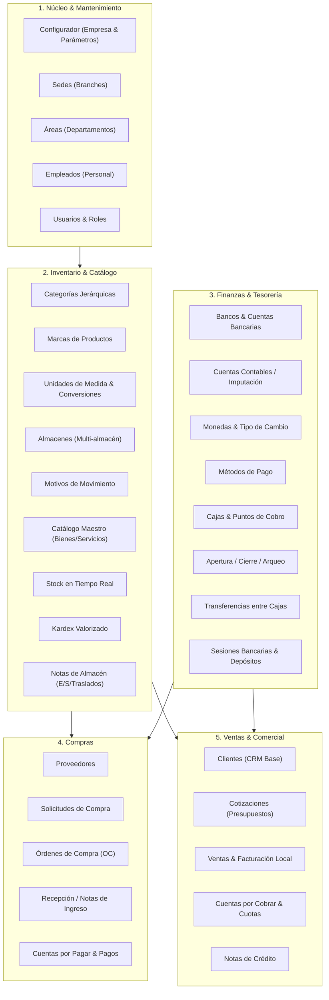

# Plan de Análisis y Migración Modular: De Multinort a Template Genérico (Laravel 12 + Vue 3)

## Resumen Ejecutivo

El objetivo es migrar un conjunto clave de módulos existentes en el proyecto **Multinort** (`/home/bienvenido/Proyecto Multinort/`) hacia la arquitectura limpia y modular de **Template Laravel Vue** (`/home/bienvenido/Template Laravel Vue/`).

La premisa es **desacoplar estos módulos del rubro de talleres mecánicos y vehículos**, transformándolos en un **ERP / Sistema de Gestión modular genérico y reutilizable** para múltiples rubros (comercio, retail, servicios profesionales, consultorías, manufactura liviana, distribución, etc.).

---

## 1. Decisiones Arquitectónicas Confirmadas

> [!IMPORTANT]
> Decisiones de diseño acordadas con el usuario:
> 1. **Alcance**: **Multi-sucursal (Sedes)** en una sola base de datos PostgreSQL, sin la sobrecarga ni complejidad de multi-tenancy (`stancl/tenancy`).
> 2. **Facturación**: Motor local completo de comprobantes (Series, Correlativos, Boletas, Facturas, Notas de Crédito, Tickets PDF) con contrato/driver desacoplado para enviar los comprobantes a SUNAT consumiendo la API REST de cualquier proveedor PSE/OSE (sin generar XML ni firma propios).
> 3. **Cuenta**: Se mantiene **Mi Cuenta / Seguridad** para el perfil del usuario autenticado (módulo `Profile`), y se implementan **Cuentas Financieras** (plan de cuentas/imputación contable) dentro del módulo de **Finanzas**.
> 4. **Marcas vs Modelos**: Se incluye **Marcas** como entidad general para clasificar productos en el catálogo maestro. **Modelos** se descarta por pertenecer al contexto específico de talleres automotrices.
> 5. **Fuera de alcance**: **Horarios** de sede (solo los consumía Citas), **Promociones**, **Membresías** y **Citas** (en Multinort exigen `vehicle_id`) no se migran.
> 6. **Empleados**: se mantiene un módulo `Employees` genérico (ficha de personal con `user_id` opcional, sede y área), sin las dependencias de taller (ODS, elevadores, despachos, herramientas). Se usa como **vendedor** (`seller_id`) en cotizaciones y ventas. La caja se opera por **usuario** y el acceso es por **rol**.
> 7. **Descuentos**: manuales por línea y globales en Cotizaciones y Ventas, con tope configurable y permiso explícito para superarlo.
> 8. **Sedes por usuario**: pivot `user_branches` con sede por defecto para filtrar caja, almacén y ventas.

---

## 2. Comparativa de Arquitectura: Origen vs. Destino

| Aspecto | Multinort (Origen) | Template Laravel Vue (Destino) |
| :--- | :--- | :--- |
| **Framework Backend** | Laravel con `stancl/tenancy` | Laravel 12 (Monolito Modular, PHP 8.3+) |
| **Claves Primarias** | Claves enteras auto-incrementales (`$table->id()`) | **UUID estricto** en todas las tablas de dominio (`$table->uuid('id')->primary()`, `HasUuids`) |
| **Organización Backend** | Controladores en `App/Http/Controllers/Tenant/...` | Módulos autocontenidos en `App/Modules/<Modulo>/` con `Controllers`, `Services`, `Models`, `Requests`, `Resources`, `Providers` |
| **Autenticación** | Laravel Sanctum | JWT (`firebase/php-jwt`) + tabla `refresh_tokens` con fingerprint de dispositivos |
| **Auditoría & Permisos** | Tablas personalizadas | `spatie/laravel-activitylog` integrado + `spatie/laravel-permission` con UUIDs |
| **Frontend Framework** | Vue 3 + Vite + Vuetify (Materio) | Vue 3 + Vite + Vuetify 3 (Materio) + Pinia |
| **Rutas Frontend** | Archivos manuales `routes.js` | Enrutamiento automático por convención (`unplugin-vue-router` en `src/pages/`) + módulos en `src/modules/` |
| **Dominio de Negocio** | Específico para taller automotriz (placas, elevadores, rayones, combustible, ODS, etc.) | **Genérico / Multi-rubro**: Catálogo de bienes y servicios, marcas, sedes, inventario multialmacén, compras, ventas y tesorería |

---

## 3. Matriz de Módulos Generalizados (Alcance Definitivo)

---

## 4. Detalle Técnico por Paquete / Módulo

### Módulo 1: `Configuration` & `Maintenance` (Organización Base)
- **Directorio Backend**: `app/Modules/Configuration/` y `app/Modules/Maintenance/`
- **Tablas de BD**:
  - `company_settings`: Razón social, identificación fiscal, dirección, logo, impuestos base (`uuid` PK).
  - `system_parameters`: Parámetros dinámicos agrupados por categoría.
  - `branches`: Sedes / Sucursales con código, dirección, teléfono y ubigeo.
  - `areas`: Departamentos internos (Ventas, Administración, Almacén, etc.).
  - `user_branches`: Sedes asignadas a cada usuario con marca de sede por defecto.
  - `employees`: Ficha de personal genérica (documento, contacto, cargo) con vinculación a sede, área y usuario del sistema opcional.
- **Frontend**:
  - Páginas: `src/pages/configuration/`, `src/pages/maintenance/branches/`, `src/pages/maintenance/areas/`, `src/pages/maintenance/employees/`.
  - Módulos en `src/modules/` con stores Pinia y servicios API.

### Módulo 2: `Inventory` (Catálogo, Stock y Movimientos)
- **Directorio Backend**: `app/Modules/Inventory/`
- **Tablas de BD**:
  - `categories`: Categorías de productos y servicios (soporta jerarquía padre-hijo).
  - `brands`: Marcas de artículos/mercadería.
  - `unit_categories` y `units`: Unidades (ej. unidad, kilogramo, litro, caja) y factor de conversión respecto a la unidad base.
  - `warehouses`: Almacenes físicos asignados a cada sede.
  - `warehouse_note_reasons`: Motivos clasificados (`in`, `out`, `transfer`) con flag de aprobación.
  - `catalog_items`: Artículos/servicios con SKU, código de barras, nombre, tipo (`product`, `service`), categoría y marca.
  - `item_presentations`: Presentaciones y precios diferenciados (costo, minorista, mayorista).
  - `stocks`: Existencias por almacén y presentación, cantidades reservadas y umbrales mínimos.
  - `kardex_movements`: Registro inmutable valorizado (entradas, salidas, saldos, costo promedio ponderado).
  - `warehouse_notes` y `warehouse_note_items`: Notas de movimiento físico (ingreso, egreso, traslado interno) con flujo `draft` -> `approved` -> `cancelled`.
- **Frontend**:
  - `src/pages/inventory/catalog/`, `src/pages/inventory/stock/`, `src/pages/inventory/kardex/`, `src/pages/inventory/notes/`, `src/pages/inventory/settings/`.

### Módulo 3: `Finance` (Tesorería, Cajas y Bancos)
- **Directorio Backend**: `app/Modules/Finance/`
- **Tablas de BD**:
  - `currencies` y `exchange_rates`: Monedas (PEN, USD, etc.) y tipos de cambio históricos.
  - `payment_methods`: Métodos de pago (efectivo, tarjeta, transferencia, yape/plin).
  - `expense_categories` y `financial_accounts`: Plan de cuentas y categorías de gastos/ingresos.
  - `banks` y `bank_accounts`: Bancos y cuentas de la empresa (moneda, número, CCI, saldo).
  - `boxes`: Cajas registradoras o puntos de venta por sede.
  - `cash_sessions`: Sesiones de caja (apertura con saldo inicial, cierre con arqueo real vs esperado, diferencia, estado).
  - `cash_transfers`: Traslados de efectivo entre cajas o a banco/bóveda con aprobación y voucher PDF.
  - `account_sessions` y `deposits`: Conciliación bancaria y depósitos con subida de comprobantes.
- **Frontend**:
  - `src/pages/finance/cash/` (Operación diaria, arqueo y corte de caja).
  - `src/pages/finance/banks/` (Movimientos bancarios, depósitos y transferencias).
  - `src/pages/finance/settings/` (Cuentas, bancos, monedas, métodos de pago).

### Módulo 4: `Purchases` (Compras & CXP)
- **Directorio Backend**: `app/Modules/Purchases/`
- **Tablas de BD**:
  - `providers`: Directorio de proveedores (datos fiscales, contactos, condiciones comerciales).
  - `purchase_requests` y `purchase_request_items`: Requerimientos internos con flujo de atención.
  - `purchase_orders` y `purchase_order_items`: Órdenes de compra formales con cálculo de impuestos.
  - `entry_notes` y `entry_note_items`: Recepción de mercadería en almacén contra OC (alimenta Stock y Kardex).
  - `accounts_payable` y `expense_payments`: Facturas de proveedores a crédito, cronograma de vencimiento y pagos desde caja/banco.
- **Frontend**:
  - `src/pages/purchases/providers/`, `src/pages/purchases/requests/`, `src/pages/purchases/orders/`, `src/pages/purchases/entries/`, `src/pages/purchases/accounts-payable/`.

### Módulo 5: `Sales` (Ventas, Cotizaciones & CXC)
- **Directorio Backend**: `app/Modules/Sales/`
- **Tablas de BD**:
  - `clients`: Clientes (ampliación del modelo actual: tipo documento, razón social, dirección, crédito).
  - `quotations` y `quotation_items`: Cotizaciones con validez, vendedor (`seller_id → employees`), descuento manual por línea y global, y PDF descargable.
  - `sales` y `sale_items`: Ventas directas o desde cotización, comprobante asociado, descuento automático de stock en almacén.
  - `sale_vouchers`: Emisión de comprobantes (Factura, Boleta, Nota de Venta) con series y correlativos independientes por sede/caja.
  - `accounts_receivable` y `income_payments`: Cuentas por cobrar para ventas al crédito, cuotas y recibos de abono en caja/banco.
  - `credit_notes` y `credit_note_items`: Notas de crédito comerciales para devoluciones o anulaciones.
- **Frontend**:
  - `src/pages/sales/quotations/`, `src/pages/sales/pos/` (Punto de Venta / Emisión), `src/pages/sales/history/`, `src/pages/sales/accounts-receivable/`, `src/pages/sales/credit-notes/`.

---

## 5. Estrategia de Implementación por Fases

| Fase | Alcance | Specs | Dependencias | Verificación |
| :---: | :--- | :--- | :--- | :--- |
| **Fase 1** | Configuración, Sedes, Áreas, Sedes por usuario y Empleados | 010, 011, 012 | Ninguna (base organizacional) | Tests de configuración, CRUD de sede/área, asignación de sedes a usuarios y empleado con usuario opcional |
| **Fase 2** | Inventario (Maestros, Catálogo, Stock, Kardex, Notas de almacén) | 013, 014, 015, 016 | Fase 1 (Sedes) | Tests de Kardex con costo promedio ponderado y traslados entre almacenes |
| **Fase 3** | Finanzas (Maestros, Cajas y sesiones, Transferencias entre cajas, Bancos) | 017, 018, 019, 020 | Fase 1 (Sedes) | Tests de apertura/cierre de caja, sobrante/faltante, transferencias y depósitos |
| **Fase 4** | Proveedores, Compras, Recepción y CXP/Gastos | 021, 022, 023, 024 | Fases 2 y 3 | Tests del ciclo OC → Nota de Ingreso → Stock → Pago |
| **Fase 5** | Clientes, Cotizaciones, Ventas/Comprobantes, CXC y Notas de Crédito | 025, 026, 027, 028, 029 | Fases 2 y 3 | Tests de emisión de venta, descarga de stock, cuotas CXC, cobros y notas de crédito |

---

## 6. Plan de Verificación y Calidad de Código

Para cada fase de desarrollo, se ejecutará el siguiente pipeline de aseguramiento de calidad antes de dar por completado cada módulo:

1. **Backend**:
   - `make artisan CMD="test"` (Suite completa de pruebas en PostgreSQL).
   - `make composer CMD="run pint"` (Formato de código según PSR-12 / Laravel).
   - `make composer CMD="run phpstan"` (Análisis estático en nivel estricto).
2. **Frontend**:
   - `npm run lint` (ESLint para Vue 3 y JavaScript).
   - `npm run build` (Verificación de compilación Vite sin errores de tipos o sintaxis).
3. **Graphify**:
   - Ejecutar `graphify update .` tras cada bloque de cambios para mantener el grafo de conocimiento actualizado.
